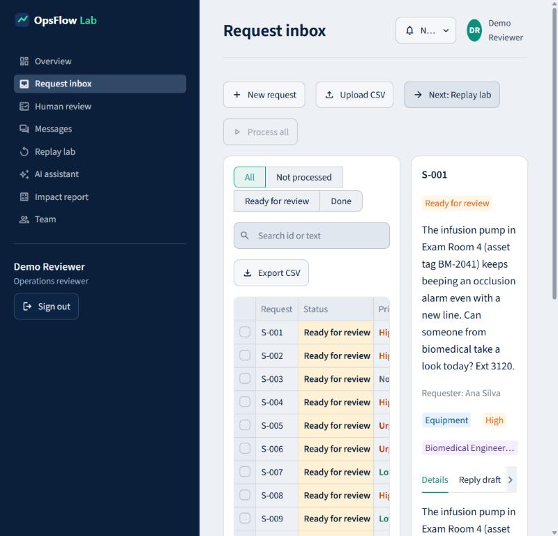
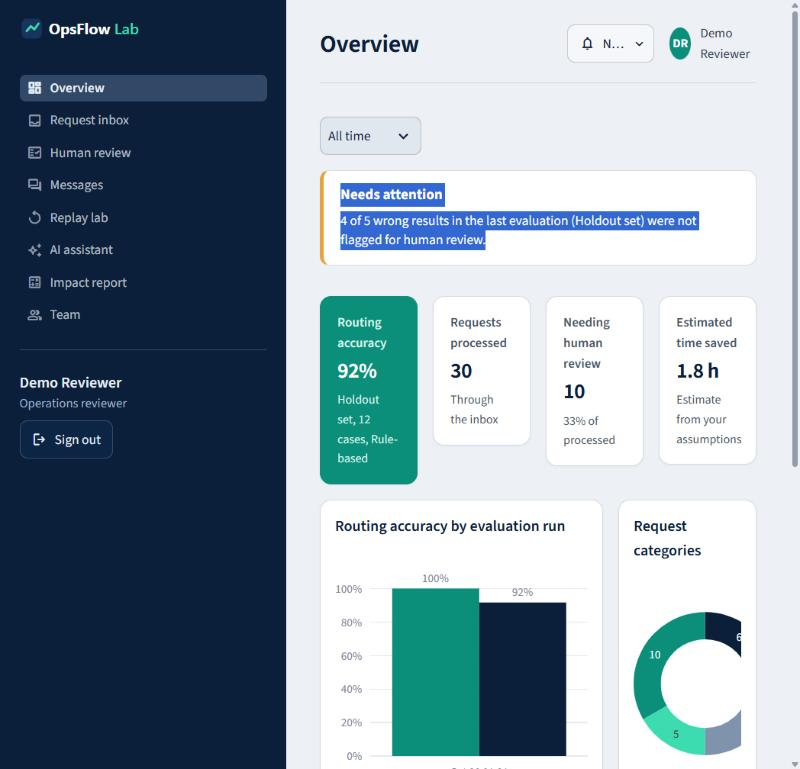
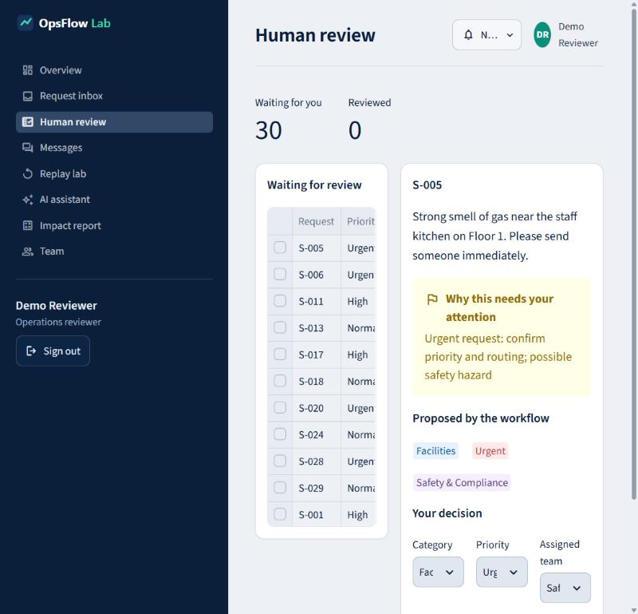
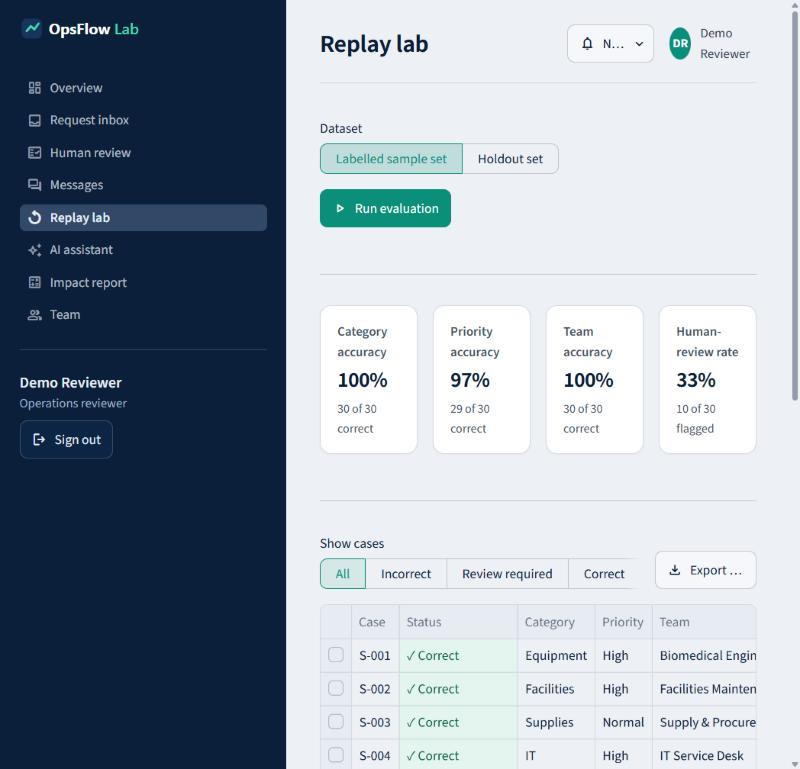
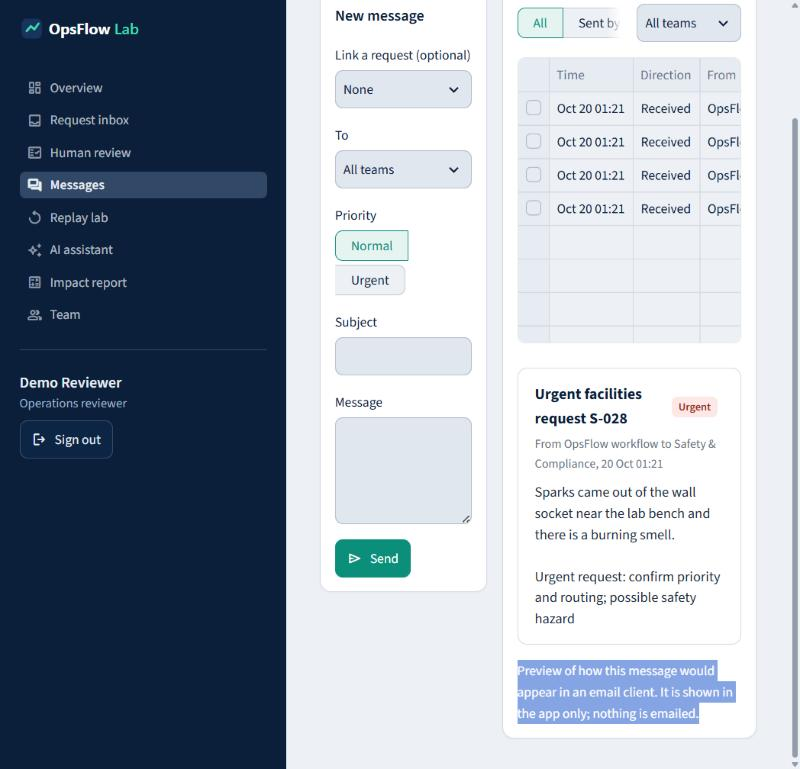
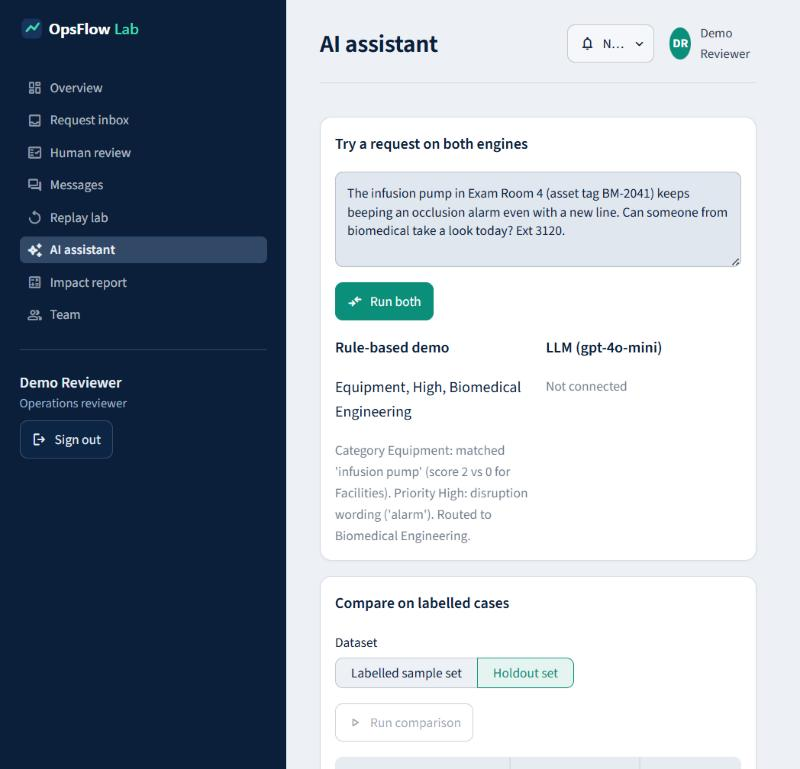
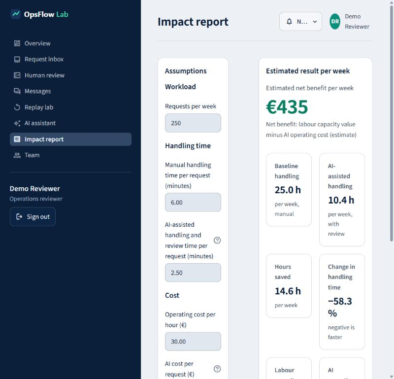

# OpsFlow Lab

**From manual work to verified AI.** A Streamlit MVP that shows how to take a repetitive business process, automate part of it with rules or an LLM, measure where it goes wrong, keep a person in control, and estimate the business impact.

> **Learning project.** Everything here is fictional: the clinic, the requests, the people and the numbers. It is not connected to any real organisation, does not use patient data, gives no medical advice, and is not affiliated with or endorsed by any employer or company.



## The problem

In many operations teams, people read every incoming request by hand: an equipment fault, a leak, a supply order, a locked account. They work out what it is, what is missing, who should handle it and how urgent it is, then write a reply. It is slow, it is inconsistent between people, and the urgent item can sit in the same pile as the routine one.

## What this project does about it

OpsFlow Lab prepares that work for a person to approve instead of doing it from scratch.

- **Triage.** Each request becomes a validated record: summary, category, priority, responsible team, extracted facts (location, item, asset tag, quantity, contact), missing information, a draft reply and a plain explanation of why.
- **Exception queue.** Urgent, ambiguous, incomplete or unprocessable requests are flagged for a person and say why.
- **Human review.** A dedicated page where a reviewer approves a proposal or changes it. Every decision is stored with who made it.
- **Measurement.** A replay lab runs the workflow against labelled cases and shows exactly which ones are wrong, and which wrong ones were *not* flagged.
- **Team messages.** An internal message feed to send one message to a team or to everyone, optionally drafted from an urgent request. Messages are stored locally; nothing is emailed.
- **Impact.** An editable calculator that turns time per request into hours and euros per week, clearly labelled as an estimate.

Nothing is sent to any external system, and no consequential action happens without a person.

## Screenshots

| | |
|---|---|
|  |  |
| Overview: measured results, needs-attention list, period filter | Human review: approve or change each proposal |
|  |  |
| Replay lab: accuracy per field and every error | Messages: notify a team or everyone |
|  |  |
| AI assistant: rule-based vs LLM side by side | Impact report: assumptions and weekly estimate |

Screenshots are from a local first launch in demo mode. On first launch the app runs the real rule-based workflow on the built-in sample queue and on both labelled sets, so every page has output from the start. No reviews are pre-filled. The window used was narrow, so wide screens show more columns.

## How it works

1. **Process** requests in the inbox (a built-in queue, a new request, or a CSV upload).
2. The **engine** produces the structured result. Output is validated against a fixed schema; anything that fails becomes a flagged "Not processed" item.
3. **Business rules** run after either engine: hazard or urgent wording raises priority, hazards route to Safety & Compliance, and missing required fields, unclear category, low confidence, very short text or urgent priority all trigger human review.
4. A person **reviews** on the Human review page. Corrections are stored and show up as adoption figures on the Overview.
5. **Replay** labelled cases to measure accuracy before anyone relies on the workflow.
6. **Estimate** the impact with your own assumptions.

## Demo mode and LLM mode

There is no switch in the interface. The app uses the LLM when an API key is configured, and the rule-based demo otherwise. The AI assistant page compares both engines.

| | Demo mode (default) | LLM mode |
|---|---|---|
| Needs a key | No | Yes, `OPENAI_API_KEY` |
| How it works | Transparent keyword rules and regular expressions in `src/triage.py` | An OpenAI model extracts, classifies, summarises and drafts a reply as JSON |
| Labelled as | "Rule-based demo (not an LLM)" | "LLM (model name)" |
| Data leaves your machine | No | **Yes**, request text is sent to the provider |
| After the engine | Deterministic business rules | The same rules, plus Pydantic validation of the model's JSON |

To enable LLM mode copy `.env.example` to `.env`, set `OPENAI_API_KEY` (and optionally `OPSFLOW_MODEL`, default `gpt-4o-mini`) and restart. `.env` is git-ignored. Keys are read from the environment only and never shown or logged. If the key is missing, the API fails or the model returns malformed JSON, the app keeps running and the request is flagged for a person.

> LLM mode is implemented and unit-tested with stubbed model responses (valid, malformed, failing, low confidence, disagreement). It has not been run against a live API in this repository.

## Setup (Windows Command Prompt)

```
py -m venv .venv
.venv\Scripts\activate
python -m pip install --upgrade pip
pip install -r requirements.txt
streamlit run app.py
```

Sign in with the prefilled demo account. On first launch in demo mode the app processes the 30 built-in sample requests and runs both replays so no page starts empty (set `OPSFLOW_AUTOSEED=0` to skip this). Demo account: `demo@opsflow.lab`, password `opsflow-demo-2026` (override with `OPSFLOW_DEMO_EMAIL` and `OPSFLOW_DEMO_PASSWORD`). Accounts are stored with salted PBKDF2 hashes in the local SQLite file and there is no self-registration. This is a demo login, not production authentication.

Run the tests:

```
python -m pytest
```

## How the evaluation metrics are calculated

- Every labelled case has an expected category, priority and team, compared case-insensitively field by field.
- **Category, priority, team accuracy** = correct cases ÷ all cases. **Routing accuracy** = category and team both correct ÷ all cases.
- Every case is in the denominator. A case that could not be processed counts as wrong on every field.
- A review flag **does not turn a wrong answer into a right one**. **Unflagged errors** (wrong results that were *not* sent to a person) is the number that matters most.

### Datasets and results

- `data/sample_requests.csv`: 30 labelled requests. This is the **development set**: the rules were written while looking at it, so scores are optimistic.
- `data/holdout_requests.csv`: 12 labelled requests **not used to tune the rules**. The rules were frozen before it was first run, and none has been changed in response to it. Small, so indicative only.
- Manually entered or uploaded requests are never added to either dataset.

Measured with the rule-based demo (deterministic, synthetic data, not production performance):

| Dataset | Routing | Category | Priority | Team | Flagged | Unflagged errors |
|---|---|---|---|---|---|---|
| Labelled sample set (30) | 100% | 100% | 97% | 100% | 10 | 1 of 1 |
| Holdout set (12) | 92% | 100% | 58% | 92% | 3 | 4 of 5 |

The holdout number is the honest one. Category routing generalises, but priority is where keyword rules miss, and most of those misses are not flagged. That gap is what an LLM, more labelled data or stricter review rules would need to close.

## Technical design

```
app.py                  Entry point, sign-in gate, grouped navigation
app_pages/              One script per page (presentation only)
src/triage.py           Schema, rule engine, LLM engine, business rules, run_triage()
src/evaluation.py       Replay, metrics, per-case status, CSV export
src/impact.py           Impact calculation (pure functions)
src/storage.py          SQLite: users, queue, results, runs, reviews, messages
src/data_io.py          CSV loading, validation, limits, template
src/config.py           Paths, limits, environment settings
src/ui_common.py        Shared Streamlit pieces (cards, header, queue bar)
data/                   Sample and holdout datasets; the SQLite file is created here
tests/                  Pytest suite
```

- Business logic is separate from Streamlit. Engines are injected as plain functions, so evaluation and LLM handling are testable without a network.
- `run_triage` never raises: failures become a flagged "Not processed" result.
- Results are held in session state and mirrored to SQLite, so a reload does not lose the queue and nothing re-calls the model when a result is redisplayed.
- The queue, results and messages are stored locally in SQLite. That includes request text so a reviewer can see it; it is fictional here. Passwords are stored only as salted hashes.
- Limits: uploads up to 1 MB and 100 rows; request text up to 2000 characters.
- Logging uses the standard `logging` module and records ids, engine and counts, never request text or secrets.

## What it does not do

- No real authentication (one demo login, no SSO, no password reset, no roles enforced).
- No email, ticketing or other integrations; replies and messages are drafts or in-app only.
- No learning from corrections: they are recorded, not fed back into the rules or prompts.
- The rule engine is English keyword matching, a transparent baseline and not a good classifier.
- Evaluation sets are small and synthetic, with no confidence intervals.
- Impact figures are what-if estimates from your assumptions, not realised savings.
- LLM mode has not been evaluated on a live model here.

## Privacy and security notes

- Demo mode keeps everything local. **In LLM mode request text, including uploaded CSV content, is sent to the LLM provider.** Use only fictional or cleared data.
- The prompt treats request text as untrusted data, but prompt injection cannot be ruled out. That is why outputs are validated, rules run afterwards and a person approves.
- `.env`, `.env.*` (except `.env.example`) and `*.db` are git-ignored. The local database holds users, queue and review history; do not commit it.
- Do not put real patient or personal data into this prototype.

## Ideas to develop it further

- Feed corrections back: turn frequent reviewer changes into new rules or few-shot examples, then re-run the holdout as a release gate.
- Add equipment status and maintenance history so triage can use asset context.
- Real identity (SSO) with roles, so only leads can change routing rules.
- Calibrated confidence and an explicit "ask for the missing information" step before routing.
- Message delivery through a sanctioned channel (for example a team chat webhook) behind an approval step.
- Monitoring of correction rate and unflagged errors over time, building on the month filter already in the Overview.

## How a project like this could help

For an operations team it shows a safe route to automation: start with a measured baseline, send uncertain cases to people, record every correction, and only then estimate savings. The same pattern fits any intake process (service desks, facilities, procurement, claims) where the question is not "can AI do this" but "how often is it wrong, and who catches it".

## Deploying safely later

- Put it behind single sign-on over HTTPS and attribute every review to a signed-in user.
- Keep secrets in the platform's secret store, never in the repository or an image.
- Move SQLite to a managed database with backups and retention rules.
- Use an LLM agreement that covers your data, redact personal data first, and add rate limits and cost caps.
- Monitor correction rate, unflagged errors and failures, and re-run the replay on every rule or prompt change.
- Keep a person approving every consequential action.
