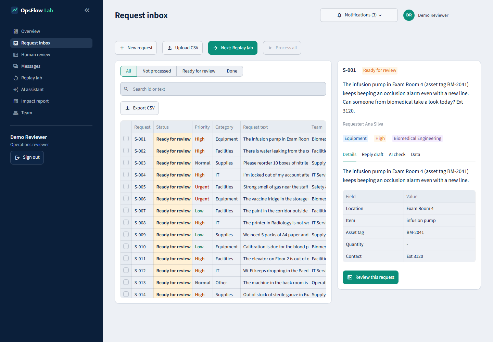
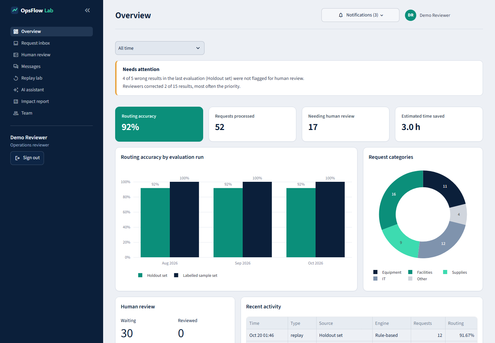
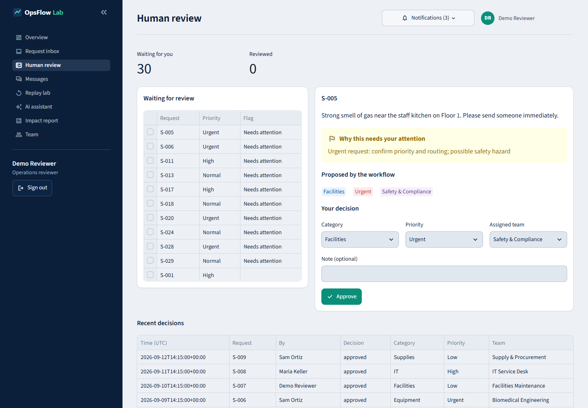
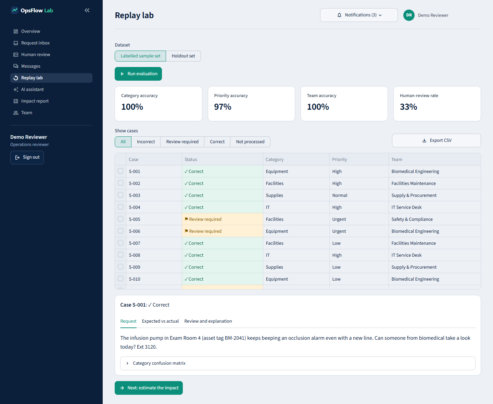
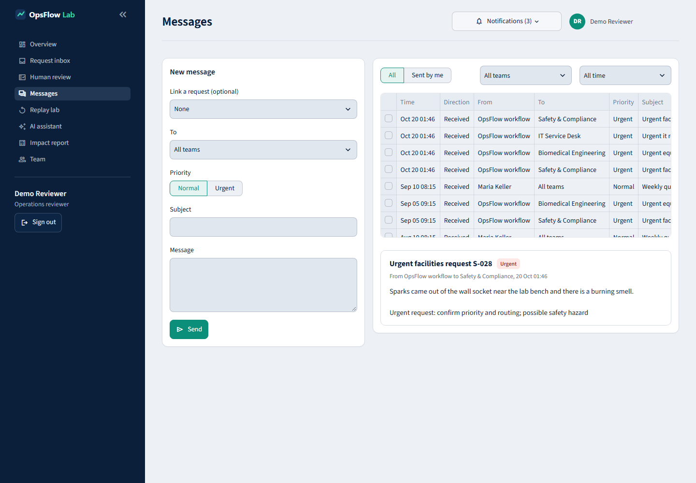
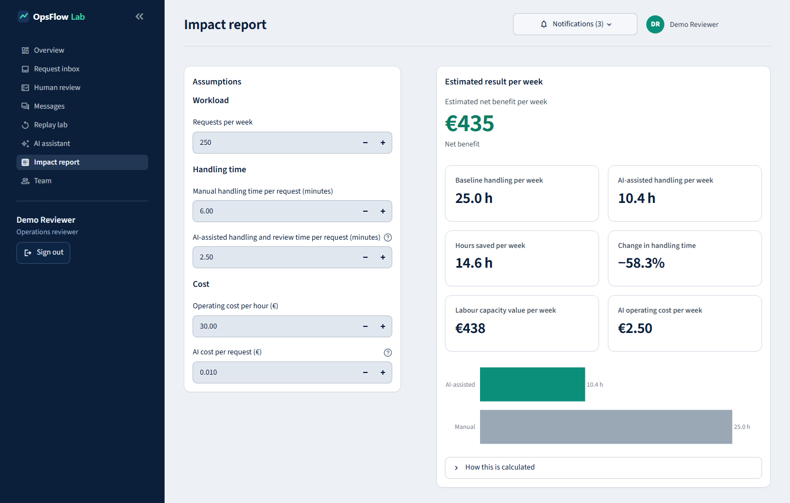

# OpsFlow Lab

A small web app that sorts incoming operational requests for a clinic's internal team, shows a person what it decided, and measures how often it is wrong.

This is a learning project. The clinic, requests, people and numbers are all made up. It uses no patient data, gives no medical advice, and is not connected to or endorsed by any real organisation.



## The problem

Staff read each request by hand: a broken infusion pump, a ceiling leak, a supply order, a locked account. For each one they decide the category, the priority and the team, note what information is missing, and write a reply. It takes time, different people decide differently, and an urgent request can sit in the same pile as a routine one.

## What the app does

- **Sorts each request.** It produces a summary, category, priority, responsible team, the details it found (location, item, asset tag, quantity, contact), what is missing, a draft reply and a short reason.
- **Flags unclear cases.** Urgent, vague, incomplete or failed requests are marked for a person, with the reason.
- **Lets a person decide.** On the Human review page you approve a result or change the category, priority or team. Each decision is saved with your name.
- **Measures errors.** The Replay lab runs the workflow on requests with known correct answers and lists every wrong result, including wrong ones that were not flagged.
- **Sends team messages.** You can write a message to one team or to everyone, or draft it from an urgent request. Messages stay inside the app; nothing is emailed.
- **Filters by month.** Overview and Messages can be limited to one month.
- **Estimates impact.** You enter weekly volume, minutes per request and costs, and it calculates hours and euros per week. These are estimates from your inputs.

Nothing is sent to any outside system, and nothing happens without a person.

## Screenshots

### Overview


### Human review


### Replay lab


### Messages


### Impact report


The AI assistant and Team pages are in `docs/screenshots` too.

## Run it (Windows Command Prompt)

```
py -m venv .venv
.venv\Scripts\activate
python -m pip install --upgrade pip
pip install -r requirements.txt
streamlit run app.py
```

Sign in with the prefilled demo account: `demo@opsflow.lab`, password `opsflow-demo-2026`. You can change them with `OPSFLOW_DEMO_EMAIL` and `OPSFLOW_DEMO_PASSWORD`. This is a demo login, not real security. Passwords are stored as salted hashes in the local database, and there is no sign-up.

On first start, the app sorts the 30 sample requests and runs both test sets, so every page has results. It also adds **demo history** for the two previous months: the same workflow is run on slices of the sample requests and the records are dated in those months, so the month filters on Overview and Messages have something to show. This history is made up for the demo and is not real usage. Because the rules never change, each month's test accuracy is the same. Set `OPSFLOW_AUTOSEED=0` to turn all of this off.

Run the tests:

```
python -m pytest
```

## Two ways to sort requests

The app picks the method itself. With no API key it uses the rules. With an OpenAI key set, it uses the model.

| | Rules (default) | Language model |
|---|---|---|
| Needs a key | No | Yes, `OPENAI_API_KEY` |
| How it works | Keyword rules and patterns in `src/triage.py` | An OpenAI model fills in the same fields as JSON |
| Shown as | "Rule-based demo (not an LLM)" | "LLM (model name)" |
| Request text leaves your computer | No | Yes, it is sent to OpenAI |
| Checks afterwards | Fixed business rules | The same rules, plus validation of the model's JSON |

To use the model, copy `.env.example` to `.env`, set `OPENAI_API_KEY` (and optionally `OPSFLOW_MODEL`, default `gpt-4o-mini`) and restart. `.env` is git-ignored. If the key is missing, the call fails or the model returns bad JSON, the request is marked "Not processed" and sent to a person.

The AI assistant page runs both methods on the same requests and shows where they disagree. The model path is tested with fake responses only. It has not been run against the real API.

## How accuracy is measured

- Each test request has a correct category, priority and team. The result is compared field by field.
- Accuracy is correct results divided by all requests. A request that failed to process counts as wrong.
- Routing accuracy means category and team are both right.
- A review flag does not make a wrong result count as right. The number to watch is wrong results that were not flagged.

There are two test sets:

- `data/sample_requests.csv` has 30 requests. I wrote the rules while looking at them, so the scores are better than they should be.
- `data/holdout_requests.csv` has 12 requests I did not look at while writing the rules. I ran them once and changed nothing afterwards.

Results for the rule-based method (invented data, so this says nothing about real use):

| Test set | Routing | Category | Priority | Team | Flagged | Wrong and not flagged |
|---|---|---|---|---|---|---|
| Sample (30) | 100% | 100% | 97% | 100% | 10 | 1 of 1 |
| Holdout (12) | 92% | 100% | 58% | 92% | 3 | 4 of 5 |

The holdout set is the fairer result. The rules get the category right, but often miss priority, and most of those mistakes are not flagged.

## Code layout

```
app.py              start page, sign-in, navigation
app_pages/          one file per page
src/triage.py       the sorting methods, validation and business rules
src/evaluation.py   test runs and accuracy numbers
src/impact.py       the impact calculation
src/storage.py      SQLite: users, requests, results, reviews, messages
src/data_io.py      CSV loading and checks
src/config.py       paths, limits, settings
src/ui_common.py    shared page pieces
data/               the two test sets (the database file is created here)
tests/              automated tests
```

Requests, results, reviews and messages are stored in a local SQLite file, including the request text so a reviewer can read it. The text is made up here. Uploads are limited to 1 MB and 100 rows, and request text to 2000 characters. Logs record ids, counts and the method used, never request text or keys.

## Limits

- One demo login. No single sign-on, no password reset, no permissions by role.
- No email or ticketing connections. Replies and messages are drafts or in-app only.
- Corrections are saved but do not change the rules.
- The rules are English keyword matching. They are a baseline, not a good classifier.
- The test sets are small and invented, and no confidence ranges are given.
- Impact numbers are what-if estimates, not savings that happened.
- With the model method, request text goes to OpenAI. Use only made-up or cleared data. The prompt treats request text as untrusted, but injection cannot be ruled out, which is why results are validated and a person approves.
- `.env` and `*.db` are git-ignored. Do not commit the database.

## Ideas for next steps

- Turn frequent corrections into new rules or example prompts, then re-run the holdout set before accepting the change.
- Add equipment status and maintenance history so sorting can use asset details.
- Add real sign-in with roles.
- Ask the requester for missing details before routing.
- Send messages through an approved channel, after a person confirms.
- Track the correction rate and unflagged errors over time.
